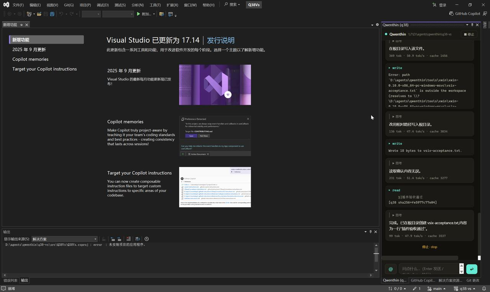

# q38-vs

**Use [q38](https://github.com/wu1w/qwenthin), the local coding agent, inside Visual Studio 2022 — a streaming chat tool window on top of a fully external agent harness.**

中文文档:[中文文档](#中文文档)(见下方)

[](https://github.com/QiruiGo/q38-vs/actions/workflows/build.yml)
[](LICENSE)


<!-- TODO: the real capture will land at docs/screenshots/tool-window.png in a later milestone -->


> **Security first:** q38 is a local console agent, not a sandboxed product. `bash` and `write` act directly on your machine; the `ask` approval gate is the primary defense. Use it in workspaces you trust. Details: [Security note](#security-note).

## Features

- **Streaming chat in a tool window** — thinking and answer arrive on separate channels, with live tokens/second.
- **Tool traces** — every `read` / `write` / `edit` / `bash` / `web` call is visible as it happens.
- **Approval cards** — each tool call can be allowed once, always allowed, or denied.
- **Solution-aware workspace** — the open solution's directory is bound automatically as the agent's working directory.
- **Built-in web search, zero API keys** — q38's `web` tool scrapes Bing + DuckDuckGo HTML with no API key, and auto-detects GBK-encoded Chinese pages. Setting a Tavily key is an optional upgrade.
- **Windows as a first-class citizen** — q38 prefers Git Bash for its `bash` tool.
- **Thin client** — the extension ships zero agent logic (see [How it works](#how-it-works)).

## How it works

q38-vs is deliberately a **thin client**: it contains no agent logic at all. It is a shell around a local `q38 web` server that exposes an HTTP + WebSocket API on `http://127.0.0.1:3848` (or the next free port). If a `q38 web` instance is already listening, the extension attaches to it; otherwise it spawns one. The agent loop, the tools and the approval flow all live in q38 and evolve with q38 releases — the extension never grows a second brain.

```
┌──────────────────────────────────────────────────┐
│                  Visual Studio 2022              │
│     q38-vs extension (VSIX) — thin client        │
│        tool window · WebView2 chat panel         │
└────────────────────────┬─────────────────────────┘
                         │ HTTP + WebSocket · localhost only
                         ▼
┌────────────────────────┴─────────────────────────┐
│           q38 web  (127.0.0.1:3848)              │
│   agent loop · tools · approvals · web search    │
│   read · write · edit · bash · web (+ mcp/skill) │
└────────────────────────┬─────────────────────────┘
                         │ OpenAI-compatible API
                         ▼
┌────────────────────────┴─────────────────────────┐
│      llama.cpp · Ollama · LM Studio · vLLM …     │
│      SGLang · any OpenAI-compatible endpoint     │
└──────────────────────────────────────────────────┘
```

The agent's tool surface comes from q38: `read` / `write` / `edit` / `bash` + `web`, plus optional `mcp` / `skill` / `view` / `search`. Approvals have three levels — `ask` / `auto` / `yolo` — and default to `ask`.

## Prerequisites

| Requirement | Notes |
| --- | --- |
| Visual Studio 2022 (17.x) | The only supported host. Older VS versions and VS Code are not supported. |
| WebView2 Runtime | Preinstalled on Windows 11 and on most Windows 10 machines. If missing, install the [Evergreen Bootstrapper](https://developer.microsoft.com/en-us/microsoft-edge/webview2/). |
| q38 CLI | `git clone https://github.com/wu1w/qwenthin`, then `cargo install --path crates/q38-cli` (Rust toolchain required). Verified build: commit `812610f` (q38 0.1.0). Upstream `main` (`60343d9`) is not yet verified with this extension. |
| Any OpenAI-compatible endpoint | llama.cpp `llama-server`, Ollama (`/v1`), LM Studio, vLLM, SGLang, or any compatible gateway. |

## Quick start

1. Install q38 and confirm `q38 --version` works. Probe your endpoint with:

   ```bash
   q38 probe --base-url http://127.0.0.1:11434/v1
   ```

   This writes `~/.q38-agent/config.toml` (you can also edit that file by hand — see [Configuration](#configuration)).

2. Check the `[server]` section of `~/.q38-agent/config.toml`: `base_url`, `api_key`, `model`. Leave `model` empty to auto-pick the first model the endpoint reports; you can also enumerate the available models and pick one (`profile = "auto"`).

3. Download the `.vsix` from [GitHub Releases](https://github.com/QiruiGo/q38-vs/releases) and double-click it to install. Open Visual Studio — the tool window appears automatically. If the extension cannot find q38, set the `Q38_BIN` environment variable to the full path of `q38.exe`.

## Configuration

The extension itself has exactly **two** settings, both environment variables:

| Variable | Purpose |
| --- | --- |
| `Q38_BIN` | Full path to `q38.exe`, used when q38 is not on `PATH`. |
| `Q38_VS_CACHE` | Overrides the WebView2 user-data (cache) directory used by the tool window. |

Everything else — endpoint, model, approvals, web search — lives in q38's own `~/.q38-agent/config.toml`. This is a deliberate design decision: the extension does not maintain a second configuration system.

Minimal example:

```toml
[server]
base_url = "http://127.0.0.1:11434/v1"   # Ollama example
api_key = "local"
model = ""                                # empty = auto-discover

[features]
approvals = "ask"                         # ask | auto | yolo

[web]
enabled = true                            # Bing + DuckDuckGo, zero keys;
                                          # set tavily_api_key to upgrade
```

## How it compares

Other VS extensions for local LLMs — LMLocal, local-llm-chat-vs, EntwineLLM and similar — embed the agent loop inside the extension. q38-vs goes the other way and externalizes the harness completely:

| | Typical VS local-LLM extensions | q38-vs |
| --- | --- | --- |
| Agent loop | Built into the extension | Fully external, in q38 |
| Client reuse | The agent lives inside the IDE | The same agent serves the Web console, the Electron desktop shell and this VS extension at the same time |
| Approvals & tool surface | Evolve per extension | Defined once in q38, shared by every client |

Because the harness is external, q38-vs works with **any OpenAI-compatible endpoint** (llama.cpp, Ollama, LM Studio, vLLM, SGLang, …). Each project has its own strengths — see their own docs for details. q38-vs is the right fit when you want the agent harness to live outside the IDE.

## Security note

**Please read this before daily use.** q38 upstream describes itself as a *local console, not a sandboxed product*: `bash` and file writes act directly on your machine. The approval gate — default `ask`, surfaced in the tool window as allow / always allow / deny cards — is the primary line of defense, and it is not a sandbox. Use q38-vs in workspaces you trust, and review each tool call before approving it.

## Roadmap

- Live monitoring of solution switches (workspace rebinds automatically)
- `@file` and editor-selection injection
- Click-to-navigate paths in tool traces
- Diff viewer for edits
- An Options page inside VS
- Session management

## License

q38-vs is released under the [MIT License](LICENSE). The upstream q38 agent is licensed under Apache-2.0; see [THIRD-PARTY-NOTICES.md](THIRD-PARTY-NOTICES.md).

---

# 中文文档

**把本地编码 agent [q38](https://github.com/wu1w/qwenthin) 接进 Visual Studio 2022 —— 架在完全外置的 agent harness 之上的流式聊天工具窗。**

English documentation: [see above](#q38-vs)

> **安全优先:** q38 是本机控制台 agent,不是沙箱产品。`bash` 与 `write` 直接作用于你的机器,默认 `ask` 的审批闸门是主要防线。请在可信的工作区使用。详见[安全须知](#安全须知)。

## 功能特性

- **工具窗内流式聊天** —— 思考与正文双通道分离输出,实时显示 tok/s。
- **工具轨迹** —— 每一次 `read` / `write` / `edit` / `bash` / `web` 调用实时可见。
- **审批卡片** —— 每次工具调用可选:本次允许 / 总是允许 / 拒绝。
- **Solution 感知工作区** —— 打开的解决方案目录自动绑定为 agent 工作区。
- **内置网页搜索,零 API key** —— q38 的 `web` 工具直接抓取 Bing + DuckDuckGo 的 HTML,不需要任何 API key;中文 GBK 页面自动嗅探编码。配置 Tavily key 可选升级。
- **Windows 一等公民** —— q38 的 `bash` 工具优先使用 Git Bash。
- **薄客户端** —— 插件本身零 agent 逻辑(见[工作原理](#工作原理))。

## 工作原理

q38-vs 刻意做成**薄客户端**:插件里不含任何 agent 逻辑。它只是本机 `q38 web` 服务的一层壳——`q38 web` 在 `http://127.0.0.1:3848`(或自动选下一个空闲端口)暴露 HTTP + WebSocket API。如果已有 `q38 web` 实例在监听,插件直接附着;否则自动拉起一个。agent 循环、工具与审批流程全部住在 q38 里,随 q38 版本一起演进——插件不会长出第二套大脑。

```
┌──────────────────────────────────────────────────┐
│                  Visual Studio 2022              │
│     q38-vs extension (VSIX) — thin client        │
│        tool window · WebView2 chat panel         │
└────────────────────────┬─────────────────────────┘
                         │ HTTP + WebSocket · 仅本机回环
                         ▼
┌────────────────────────┴─────────────────────────┐
│           q38 web  (127.0.0.1:3848)              │
│   agent loop · tools · approvals · web search    │
│   read · write · edit · bash · web (+ mcp/skill) │
└────────────────────────┬─────────────────────────┘
                         │ OpenAI 兼容 API
                         ▼
┌────────────────────────┴─────────────────────────┐
│      llama.cpp · Ollama · LM Studio · vLLM …     │
│      SGLang · any OpenAI-compatible endpoint     │
└──────────────────────────────────────────────────┘
```

agent 的工具面由 q38 提供:`read` / `write` / `edit` / `bash` + `web`,另有可选的 `mcp` / `skill` / `view` / `search`。审批分三档——`ask` / `auto` / `yolo`——默认 `ask`。

## 前置要求

| 需求 | 说明 |
| --- | --- |
| Visual Studio 2022(17.x) | 唯一支持的宿主;不支持更早的 VS 版本,也不支持 VS Code。 |
| WebView2 运行时 | Win11 自带;Win10 大多自带。缺失时安装 [Evergreen Bootstrapper](https://developer.microsoft.com/en-us/microsoft-edge/webview2/)。 |
| q38 CLI | `git clone https://github.com/wu1w/qwenthin` 后执行 `cargo install --path crates/q38-cli`(需要 Rust 工具链)。已验证构建:commit `812610f`(q38 0.1.0);上游 `main`(`60343d9`)尚未验证。 |
| 任意 OpenAI 兼容端点 | llama.cpp 的 `llama-server`、Ollama(`/v1`)、LM Studio、vLLM、SGLang 或其他兼容网关。 |

## 快速上手(三步)

1. 安装 q38 并确认 `q38 --version` 可用。探测端点:

   ```bash
   q38 probe --base-url http://127.0.0.1:11434/v1
   ```

   该命令会写入 `~/.q38-agent/config.toml`(也可以手动编辑,见[配置](#配置))。

2. 检查 `~/.q38-agent/config.toml` 的 `[server]` 段:`base_url` / `api_key` / `model`。`model` 留空则自动取端点返回的第一个模型;也可以先枚举可用模型再手填(`profile = "auto"`)。

3. 从 [GitHub Releases](https://github.com/QiruiGo/q38-vs/releases) 下载 `.vsix` 双击安装。打开 Visual Studio,工具窗自动出现。若插件找不到 q38,设置环境变量 `Q38_BIN` 指向 `q38.exe` 的完整路径。

## 配置

插件自身只有**两个**配置项,均为环境变量:

| 变量 | 用途 |
| --- | --- |
| `Q38_BIN` | `q38.exe` 的完整路径;q38 不在 `PATH` 时使用。 |
| `Q38_VS_CACHE` | 覆盖工具窗使用的 WebView2 用户数据(缓存)目录。 |

其余一切——端点、模型、审批、网页搜索——都在 q38 自己的 `~/.q38-agent/config.toml` 里配置。这是刻意的设计决策:插件不做第二套配置。

精简示例:

```toml
[server]
base_url = "http://127.0.0.1:11434/v1"   # Ollama 示例
api_key = "local"
model = ""                                # 留空自动发现

[features]
approvals = "ask"                         # ask | auto | yolo

[web]
enabled = true                            # Bing + DuckDuckGo 零 key 开箱即用;
                                          # 有 Tavily key 填 tavily_api_key 升级
```

## 与同类项目的差异

其他 VS 本地 LLM 插件——LMLocal、local-llm-chat-vs、EntwineLLM 等——把 agent 循环内建在扩展里。q38-vs 反其道而行,把 harness 完全外置:

| | 常见 VS 本地 LLM 插件 | q38-vs |
| --- | --- | --- |
| agent 循环 | 内建在扩展内 | 完全外置,位于 q38 |
| 多端复用 | agent 只活在 IDE 里 | 同一 agent 可同时被 Web 控制台、Electron 桌面壳与本 VS 插件使用 |
| 审批与工具面 | 随各扩展各自演进 | 在 q38 统一定义、统一演进 |

因为 harness 外置,q38-vs 可以对接**任意 OpenAI 兼容端点**(llama.cpp、Ollama、LM Studio、vLLM、SGLang 等)。各项目各有侧重,具体能力以各自文档为准;如果你希望 agent harness 活在 IDE 之外,q38-vs 就是合适的选择。

## 安全须知

**日常使用前请务必阅读。** q38 上游对自身的定位是"本机控制台,非沙箱产品":`bash` 与文件写入直接作用于你的机器。审批闸门——默认 `ask`,在工具窗中呈现为"本次允许 / 总是允许 / 拒绝"卡片——是主要防线,但它不是沙箱。请在可信的工作区使用 q38-vs,并在批准前逐条审查工具调用。

## 路线图(Roadmap)

- Solution 切换实时监听(自动重绑工作区)
- `@文件` 与编辑器选区注入
- 工具轨迹中的路径可点击跳转
- 编辑 Diff 查看
- VS 内的 Options 设置页
- 会话管理

## 许可证

q38-vs 以 [MIT License](LICENSE) 发布。上游 q38 采用 Apache-2.0,见 [THIRD-PARTY-NOTICES.md](THIRD-PARTY-NOTICES.md)。
